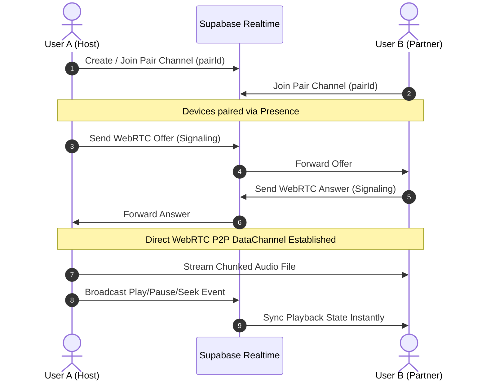

# 🎧 Listen Together

[](https://flutter.dev)
[](https://dart.dev)
[](https://supabase.com)
[](https://webrtc.org)
[](https://opensource.org/licenses/MIT)

> A private, real-time synchronized music experience designed for two people to listen, share, and vibe together wherever they are.

---

## ✨ Features

- 👫 **Private Two-Person Pairing**: Connect paired devices securely using unique pairing codes with persistent device identity.
- ⚡ **Peer-to-Peer File Transfer (WebRTC)**: Send complete high-fidelity audio files directly between devices using WebRTC Data Channels with STUN/TURN relay fallback.
- 🔄 **Real-Time Playback Synchronization**: Simultaneous playback controls (play, pause, seek, track changes) powered by Supabase Realtime Presence and Broadcast streams.
- 🎶 **Collaborative Playlists & Shared Library**: Build and curate music collections together with sender context, timestamps, and live updates.
- 📶 **Offline & Local Cache**: Save and play transferred audio tracks locally using cached storage without requiring continuous re-downloads.
- 🎨 **Modern Soft Pastel UI**: Thoughtfully crafted UI with smooth micro-interactions, responsive seek bars, full-screen player drawer, queue management, and dark/light pastel aesthetics.

---

## 🛠️ Architecture & Tech Stack

| Component | Technology | Description |
|---|---|---|
| **Framework** | [Flutter](https://flutter.dev) & Dart | Cross-platform client for Mobile, Web, and Desktop |
| **Audio Engine** | [`just_audio`](https://pub.dev/packages/just_audio) | Gapless audio playback with precise seeking and buffer controls |
| **Signaling & Sync** | [`supabase_flutter`](https://pub.dev/packages/supabase_flutter) | Realtime presence channels, signaling exchange, and session state sync |
| **P2P Data Channel** | [`flutter_webrtc`](https://pub.dev/packages/flutter_webrtc) | Chunked peer-to-peer binary transfer for local audio files |
| **Local Storage** | [`shared_preferences`](https://pub.dev/packages/shared_preferences) | Client persistence for Pair ID, Device ID, and offline state |

---

## 📁 Project Structure

```text
lib/
├── main.dart                   # Application entry point
└── src/
    ├── app.dart                # App lifecycle & theme configuration
    ├── config.dart             # WebRTC ICE / STUN / TURN configurations
    ├── data/                   # Seed & mock library data
    ├── models/                 # Data models (Song, PlaybackSession, Playlist)
    ├── services/
    │   ├── local_store.dart       # Device & cache persistence
    │   ├── playback_service.dart  # Audio player controller wrapper
    │   ├── supabase_service.dart  # Supabase client & Realtime signaling
    │   └── webrtc_service.dart    # WebRTC DataChannel file transfer service
    ├── state/
    │   └── app_controller.dart    # Central state management & orchestration
    ├── theme/                  # Color palettes, typography & styles
    └── ui/
        ├── app_shell.dart         # Main navigation, player bar & library views
        ├── pairing_flow.dart      # Device pairing & QR/code entry screens
        ├── shared_ui.dart         # Reusable widgets (cards, buttons, sliders)
        └── supabase_setup.dart    # In-app Supabase credentials setup modal
```

---

## 🚀 Getting Started

### Prerequisites

- [Flutter SDK](https://docs.flutter.dev/get-started/install) (v3.19.0 or higher recommended)
- [Dart SDK](https://dart.dev/get-dart)
- A [Supabase](https://supabase.com) account (free tier works great)

### 1. Clone the repository

```bash
git clone https://github.com/<your-username>/listen-together.git
cd listen-together
```

### 2. Install dependencies

```bash
flutter pub get
```

### 3. Setup Supabase backend

Create a Supabase project and run the following SQL schema in the SQL Editor to enable session sync:

```sql
create table if not exists playback_sessions (
  pair_id text primary key,
  current_song_id text,
  position_ms bigint default 0,
  is_playing boolean default false,
  updated_at timestamp with time zone default timezone('utc'::text, now())
);

-- Enable Realtime for playback_sessions
alter publication supabase_realtime add table playback_sessions;
```

You can configure your Supabase URL and Anon Key directly inside the app settings screen on launch, or wire them into your environment config.

### 4. Run the application

```bash
flutter run
```

---

## 🤝 How Pairing & Sync Works



---

## 📄 License

This project is licensed under the MIT License — see the [LICENSE](LICENSE) file for details.
